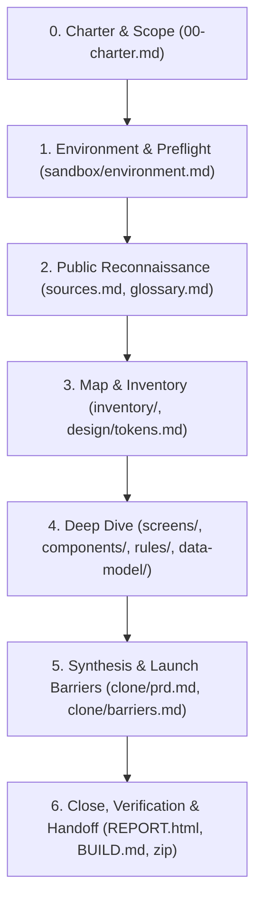

# REM | Execution, Governance & Verification Workflow

REM structures reverse engineering and software reconstruction into explicit dependency phases, safety boundaries, and reproducible verification gates.

---

## 1. Safety Framework & Environment Governance

Every reverse-engineering investigation must adhere to strict safety governance to ensure that live testing never damages production data or notifies real people.

### 1.1. Environment Levels

| Level | Definition | Allowed Action Classes |
|:---|:---|:---|
| **L1 Dedicated Account** | Isolated trial or sandbox account in a separate browser profile with no access to production sessions. | A0, A1, A2, A3, A4 |
| **L2 Separate Workspace** | New workspace or company created under the operator's account with no other members. | A0, A1, A2, A3, A4 (workspace creation only) |
| **L3 Sandbox Container** | Isolated container (list, project, or pipeline) named `🧪 [RE] Sandbox` inside an existing account. | A0, A1, A2 (inside container only) |
| **L4 Observe Only** | Production observation with zero writes permitted. | A0 (read-only navigation & screenshots) |

### 1.2. Action Classes

- **A0 Read**: Navigation, inspecting DOM, reading stylesheets, taking screenshots.
- **A1 Transient UI**: Opening/closing menus, modal cancellation, unsaved filters/sorting.
- **A2 Sandbox Data**: Creating, updating, or deleting records prefixed with `[RE]` strictly inside the sandbox container.
- **A3 Personal Preference**: Modifying operator-specific theme or display settings (restored before session end).
- **A4 Shared Configuration**: Creating workspace-level custom fields, statuses, or automations scoped to operator-only targets.
- **A5 Outbound / Irreversible (FORBIDDEN)**: Sending emails, invites, notifications, or webhooks to anyone other than the operator; deleting records not tracked in the ledger; accepting billing terms or paid subscriptions.

### 1.3. The Write Gate

Before executing any A2, A3, or A4 action:
1. **Location Check**: Current breadcrumb and URL match `sandbox/environment.md`.
2. **Audience Check**: Only the operator is assigned or notified.
3. **Undo Check**: An explicit reversal/teardown path is verified.
4. **Ledger Check**: Mutation is recorded in `sandbox/ledger.csv` with before/after state.

---

## 2. Evidence Tagging & Namespace Taxonomy

To eliminate hallucinated claims, every assertion in the Knowledge Base must cite verified evidence:

| Tag | Meaning | Requirement |
|:---|:---|:---|
| `[obs EV-###]` | Directly observed in the target interface | Screenshot or DOM observation file exists in `evidence/` |
| `[net EV-###]` | Observed via network traffic | Captured API endpoint schema or network response |
| `[doc SRC-###]` | Documented in public sources | Authoritative citation recorded in `sources.md` |
| `[inf Q-###]` | Inferred behavior | Linked to an open hypothesis question in `questions.md` |

### Identifier Prefixes

- `FL-###`: User Journey Flows
- `SRC-###`: External Documentation Sources
- `EV-###`: Forensic Evidence Records (legacy `E-###` supported for backward compatibility)
- `BR-###`: Launch Barriers & Regulatory Moats
- `F-###`: Functional Features Catalog
- `S-###`: Screen Interfaces
- `C-###`: Reusable UI Components
- `R-###`: Business Logic Rules (Given/When/Then)
- `ENT-###`: Data Model Entities
- `B-###`: Unexpected Findings & Anomalies
- `Q-###`: Open Hypotheses & Questions
- `L-###`: Sandbox Mutation Ledger Entries

---

## 3. Seven-Phase Execution Pipeline

### Phase 0: Charter & Scope Discovery
- Define objective, project mode (`idea`, `recon-only`, `clean-room`, `source-informed`), target endpoints, and terms URL in `00-charter.md`.
- Exit Gate: Approved charter with explicit boundaries and acceptance criteria.

### Phase 1: Environment & Preflight
- Assess available environment level (L1–L4) and document baseline in `sandbox/environment.md`.
- Verify that active automations or webhooks will not trigger on sandbox actions.
- Exit Gate: Verified environment baseline and empty, initialized `sandbox/ledger.csv`.

### Phase 2: Public Reconnaissance
- Collect public documentation, API specifications, and pricing architecture into `sources.md`.
- Establish ubiquitous domain terminology in `glossary.md`.
- Conduct initial launch barrier scan in `clone/barriers.md`.
- Exit Gate: Pinned public evidence baseline with stable `SRC-###` citations.

### Phase 3: Map & Inventory
- Run browser extraction scripts:
  * `inventory.js`: Catalog all screens, frameworks, component tags, and SDKs.
  * `tokens.js`: Extract typography scale, CSS variables, and OKLCH color palettes.
- Populate `inventory/screens.md`, `inventory/features.md`, and `inventory/coverage.md`.
- Exit Gate: Initial screen/feature inventory indexed with zero unmapped top-level routes.

### Phase 4: Deep Dive (Feature-by-Feature)
- For each feature in `inventory/coverage.md`:
  1. Plan state fixtures (empty, typical, loading, error, permission-gated) in `sandbox/fixtures.md`.
  2. Capture two-tier physically masked screenshots using `mask.js` and annotate regions using `annotate.js`.
  3. Formalize business logic into Given/When/Then rules (`rules/R-###.md`) with explicit `[obs EV-###]` evidence tags.
  4. Infer data model entities (`data-model/entities/ENT-###.md`) and API payload schemas.
- Exit Gate: 100% of prioritized features documented with passing evidence tags.

### Phase 5: Synthesis & Launch Barrier Analysis
- Formulate rebuild PRD (`clone/prd.md`) with clear phase build orders.
- Author parity acceptance matrix (`clone/parity.md`).
- Audit regulatory moats, required certifications (SOC 2, ISO 27001), partner API approvals, and app store gatekeepers in `clone/barriers.md` (`BR-###`).
- Exit Gate: Actionable rebuild specification and scored launch barrier ledger.

### Phase 6: Close, Verification & Handoff
- Reconcile `sandbox/ledger.csv`: ensure all mutations are restored or removed.
- Run validation: `./rem kb check <kb-dir> --closing` (must return 0 errors).
- Compile interactive, CSP-hardened report: `./rem kb report <kb-dir>`.
- Package coding-agent build kit: `./rem kb pack <kb-dir>` (generates `BUILD.md` and sanitized handoff zip).
- Exit Gate: Delivered `REPORT.html` and coding-agent handoff bundle with `verifiedGeneration == mutationGeneration`.
